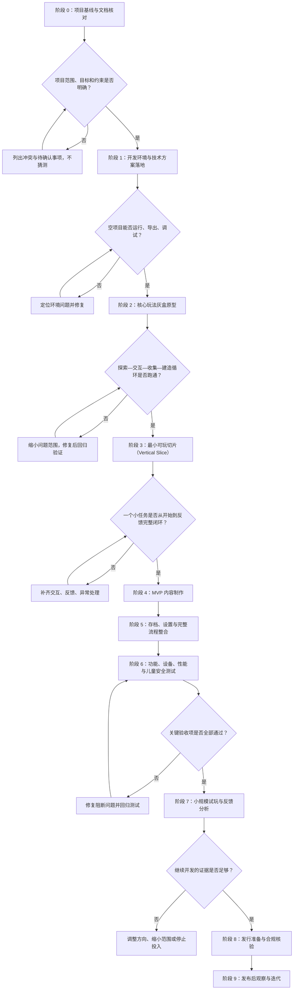

# 奇趣小岛｜整体开发路线图

- 文档版本：V1.0
- 文档用途：作为整个项目的开发总纲；后续每次只推进一个阶段，并按验收结果决定是否进入下一阶段。
- 项目类型：面向中国大陆 6–8 岁儿童的轻探索、轻任务、收集、建造与装饰手游。
- 开发原则：小步交付、先验证核心玩法、控制范围、保护既有文档与用户改动。

## 一、整体流程图



## 二、阶段总览

| 阶段 | 阶段名称 | 主要目标 | 主要交付物 | 进入下一阶段的条件 |
|---|---|---|---|---|
| 0 | 项目基线与文档核对 | 统一需求、范围、技术选择和不可变约束 | 本路线图、决策记录、待确认清单 | 文档无关键冲突；未决事项已明确标注 |
| 1 | 开发环境与技术方案落地 | 确认引擎、项目结构、运行和导出链路 | 可运行的空项目、环境说明、最小验证记录 | 能在目标开发设备运行并完成一次导出验证 |
| 2 | 核心玩法灰盒原型 | 验证最关键的操作与玩法循环 | 可移动角色、交互点、资源收集、建造反馈 | 不依赖正式美术即可完整跑通核心循环 |
| 3 | 最小可玩切片 | 把一个小任务做成端到端体验 | 一个可体验小区域、一位伙伴、一个完整任务、一次建造 | 新玩家能理解目标并完成任务，反馈清楚 |
| 4 | MVP 内容制作 | 按策划范围补齐首版内容 | 1 张岛屿、3 位动物伙伴、约 12 个任务、约 15 件装饰、3 个建造点、1 个解锁区域 | MVP 清单逐项完成，无明显范围膨胀 |
| 5 | 存档与流程整合 | 保证退出重进后进度可靠，菜单与游戏流程完整 | 本地存档、开始/继续游戏、基础设置、重置存档确认 | 关键进度能正确保存、读取及处理异常 |
| 6 | 质量、设备与安全测试 | 发现崩溃、卡关、性能、易用性与安全问题 | 测试清单、问题清单、修复记录、候选版本 | 阻断级问题清零；重要问题有明确处理决定 |
| 7 | 小规模试玩与验证 | 用真实试玩判断是否值得继续投入 | 试玩记录、家长反馈、问题优先级、继续/调整/停止建议 | 基于证据形成明确的下一步决策 |
| 8 | 发行准备与合规核验 | 确认目标平台、发布材料及中国大陆适用要求 | 发布清单、隐私与权限核对、素材授权清单、发行计划 | 平台和法规要求核实完成；未满足事项不带入发布 |
| 9 | 发布后观察与迭代 | 按真实反馈改进体验 | 版本计划、问题优先级、更新说明 | 每次迭代有明确目标和回归验证 |

> 时间只是初步规划，不是承诺。之前的约 8 周估算可作为“原型到初步试玩”的目标参考；若环境、素材或试玩发现较大问题，应以验收质量优先，不为赶进度跳过阶段。

## 三、每个阶段的统一工作流程

```text
读取项目总纲与相关 docs
        ↓
明确本阶段目标、范围和禁止改动项
        ↓
Codex 先只读检查现状与依赖
        ↓
输出实施计划、风险和验收标准
        ↓
用户确认计划
        ↓
只实施当前阶段，不顺手扩展需求
        ↓
运行与本阶段相关的最小必要验证
        ↓
汇报改动文件、验证结果、遗留问题
        ↓
用户验收
   ┌────┴────┐
 未通过       通过
   ↓           ↓
修复并回归   记录阶段完成，进入下一阶段
```

### 每轮 Codex 任务必须包含

1. **本轮目标**：只写一个阶段目标或一个可独立验收的小任务。
2. **先检查再计划**：先阅读相关代码、配置、文档和当前工作区状态。
3. **修改边界**：列明允许修改的文件/模块，以及明确禁止碰触的部分。
4. **验收标准**：写成可以验证的结果，而不是“看起来没问题”。
5. **验证范围**：只运行与改动相关的必要检查；如果测试/构建成本高，先说明原因与方案。
6. **结果报告**：改了什么、如何验证、结果如何、还剩什么风险。
7. **阶段门禁**：未达到验收标准时，不宣称阶段完成，不自动进入后续阶段。

## 四、第一阶段具体安排：开发环境与技术方案落地

在阶段 0 的文档核对完成后，第一阶段先完成技术基线，不直接开始大规模做游戏内容。

### 任务 1：检查项目与文档

- 阅读 `docs/` 下的立项说明书、GDD、MVP 开发规格与技术方案、AI 开发提示词、测试与儿童安全清单。
- 检查当前目录、现有代码、引擎版本、依赖和已有改动。
- 标记文档冲突、缺失决策和不应由 AI 自行猜测的内容。
- 不覆盖或删除用户已有文件，不因“整理”而重写已确认的产品决定。

### 任务 2：确定技术选择

- 若尚未选定引擎，优先评估 Godot 4；如果开发者已熟悉 Unity，则基于实际熟悉程度、目标平台和导出要求做比较后再定。
- 明确首发目标设备/操作系统、屏幕方向、输入方式、最低性能目标。
- 明确资源格式、场景组织、存档方案和版本控制规则。
- 发行平台、商业化和合规要求只记录待核实项，不在证据不足时假定已满足。

### 任务 3：搭建最小可运行项目

- 创建清晰、不过度设计的目录结构。
- 建立启动场景、基础输入、简单占位画面和错误日志机制。
- 确保项目能启动、能调试、能导出一个最小构建。
- 暂不开发完整地图、任务系统、正式美术、广告、内购、联网、账号或多人功能。

### 任务 4：形成技术基线记录

至少记录：
- 引擎与版本、语言、开发环境和导出目标；
- 项目目录职责；
- 启动、运行、调试、导出步骤；
- 当前已验证事项和未验证事项；
- 已知风险及后续处理方式。

### 阶段 1 验收标准

- [ ] 引擎与版本已明确，并有选择理由。
- [ ] 项目可在开发环境启动，无阻断级错误。
- [ ] 最小构建可成功导出，并在目标设备或可用模拟环境中启动。
- [ ] 目录结构和运行方式有文档记录。
- [ ] 没有提前加入本阶段不需要的账号、网络、广告、内购或多人系统。
- [ ] 相关验证结果和遗留问题已汇报，等待用户验收。

## 五、MVP 范围控制

### 首版计划内

- 一张可探索的小岛地图；
- 三位动物伙伴；
- 约十二个短任务；
- 基础资源收集；
- 三个主要修复/建造点；
- 约十五件可摆放装饰；
- 一个可解锁区域；
- 本地存档和清楚的操作反馈。

### 首版暂不做

- 账号登录、云存档和在线服务；
- 多人联机、公开聊天、陌生人社交；
- 广告 SDK、内购和随机付费抽取；
- 大规模地图、复杂经济系统、排行榜；
- 未经验证的复杂剧情、活动系统或可无限扩张的内容制作工具。

新增需求先进入“候选需求清单”，说明价值、成本、风险和优先级；未经确认，不进入当前阶段。

## 六、验收与问题优先级

- **P0 阻断**：无法启动、存档丢失、主要流程无法完成、严重安全或隐私风险。必须修复后才能通过。
- **P1 重要**：核心交互不清楚、任务无法完成、频繁卡顿或关键设备适配问题。原则上在阶段验收前修复。
- **P2 一般**：局部视觉、动画或不影响核心流程的小问题。记录后按成本和收益排期。
- **P3 优化**：非必要扩展和锦上添花的改进。默认不阻塞当前阶段。

每个问题都记录：复现步骤、预期结果、实际结果、影响范围、优先级和验证结果。

## 七、项目决策记录

重大选择应记录日期、选项、结论、原因和影响，避免后续 AI 在不同会话中反复猜测。

| 决策项 | 当前状态 | 说明 |
|---|---|---|
| 暂定名称 | 已提出 | 奇趣小岛，可后续调整 |
| 目标年龄 | 初步确定 | 6–8 岁 |
| 核心玩法 | 初步确定 | 探索、帮助、收集、建造、装饰 |
| 首版网络策略 | 初步确定 | 离线优先；不做账号、广告、内购和在线社交 |
| 游戏引擎 | 待最终确认 | 优先评估 Godot 4；结合开发者熟悉度和目标平台决定 |
| 目标平台与屏幕方向 | 待确认 | 在技术基线阶段确定 |
| 商业模式与定价 | 待验证 | 不把任何价格假设当作已验证结论 |
| 正式发行合规 | 待核实 | 发布前核验适用审批、未成年人保护、隐私和平台要求 |

## 八、项目执行规则

- 一次只推进一个阶段；每个阶段拆成小任务。
- 高风险或边界不清的任务，先只读审计并提交计划，等用户确认后再修改。
- 不猜测业务规则、外部接口、平台要求或未确认的技术决策。
- 不做与当前任务无关的重构，不因局部任务重写整体架构。
- 不覆盖用户未提交的修改，不执行未获授权的破坏性操作。
- 默认不执行 Git 写操作（包括 commit、push、pull、fetch、merge、rebase、checkout、switch、reset、stash、branch）；如确有需要，先单独征求用户确认。
- 每次完成后更新阶段状态和决策记录；只有用户验收后才进入下一阶段。

## 九、建议的执行顺序

1. 先让 Codex 只读检查项目根目录与 `docs/`，对照本路线图列出实际情况和差异。
2. 用户确认技术选择、目标平台和阶段 1 验收标准。
3. 完成阶段 1 的最小可运行项目与技术基线文档。
4. 验收后进入阶段 2，只做核心玩法灰盒原型。
5. 每阶段结束都复盘、记录结果，再进入下一阶段。

**当前建议状态：阶段 0（项目基线与文档核对）待 Codex 对实际项目进行只读检查；不要默认项目目录为空，也不要直接开始大规模编码。**
