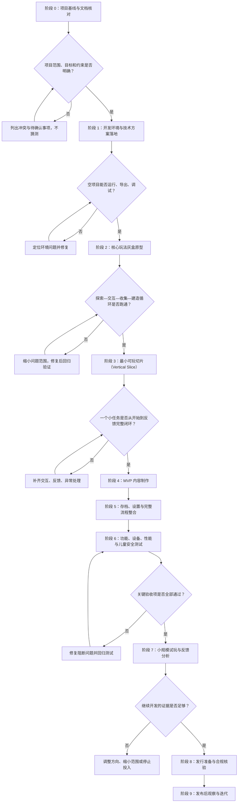
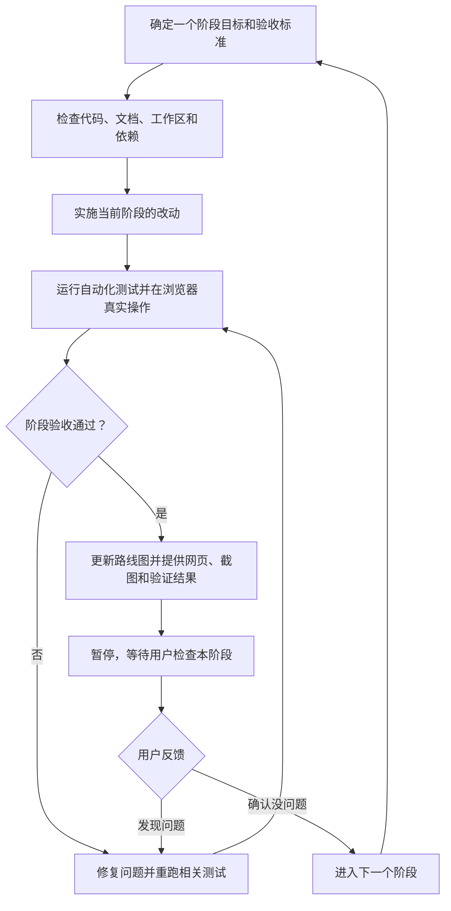

# 奇趣小岛｜整体开发路线图

- 文档版本：V1.0
- 文档用途：作为整个项目的开发总纲；后续每次只推进一个阶段，并按验收结果决定是否进入下一阶段。
- 项目类型：面向中国大陆 6–8 岁儿童的轻探索、轻任务、收集、建造与装饰手游。
- 开发原则：小步交付、先验证核心玩法、控制范围、保护既有文档与用户改动。

## 当前项目判断与产品方向（2026-10-22）

**产品方向：**把《奇趣小岛》做成一款温暖、低压力的 2D 岛屿修复与装饰游戏。玩家探索小岛、帮助动物完成短任务、收集并摆放物品，让环境出现看得见的变化。主线要有一个清楚的庆祝结尾；结尾之后仍可完成支线并自由探索。它不以复杂经营、战斗或付费系统为目标。

**玩家循环：**看懂一个当前目标 → 在岛上探索并互动 → 收集、拖拽或建造 → 看到岛屿和伙伴发生变化 → 收到简短反馈并得到下一个目标。对 6–8 岁玩家，任何时刻都应突出一个当前任务和一个直接的下一步；完成反馈短暂显示，已解锁区域、旧对话和未使用的空槽不应继续占据注意力。

**当前真实进度：**项目已从环境搭建进入可玩灰盒原型。Godot 4.7.2、浏览器预览和自动化回归链路已建立；Q001–Q006 主线建造、Q012 庆祝结尾和 Q007–Q011 结尾后支线已连通；72 项自动化套件覆盖状态、运行时输入和存档迁移。已用全新浏览器存档通过真实按键和拖拽走完 Q001–Q012，再从主线完成存档真实操作走完 Q007–Q011；浏览器检查覆盖种下种子后的狐狸引导、乌龟花园、支线绿框拖放、终局、建造调整和刷新存档。当前完成了任务操作提示、虚拟摇杆和触控按钮布局修订，等待用户在网页验收；目标玩家试玩仍待安排。它还不是内容和美术完成的 MVP：画面以程序绘制的灰盒素材为主，目标平台和真实试玩也尚未确定。

**本轮已完成：**种下种子后，兔子会接着提示玩家去帮狐狸收集 3 份木材；狐狸入住后兔子暂时退场，直到主线庆祝时再出现。主线 HUD 现在显示 1/7 至 7/7 步数，结尾后的五项支线显示“可选 1/5 至 5/5”；每段底部提示只写当前操作，乌龟花园拆成浇水、收集、摆放三个连续步骤。额外地块放满 3 件物品后，整理入口会关闭、已布置场景保留，终局明确显示“没有必做任务”，并把建造调整和自由探索作为可选去向；进入建造调整时也会说明如何移动或收回已摆放装饰。鸟屋问候和新花回访也明确标为可选。Q006 装饰首次完成后会引导玩家回兔子处触发 Q012，结尾后开放 Q007–Q011。已用真实浏览器输入走完贝壳、鸟屋材料与问候、种子收藏、石板铺路和额外地块整理；检查发现 Q008 路面拖拽缺少绿色目标提示，现已补上所有空槽的绿色可放提示和悬停高亮。Q010 完成后，旧鸟屋和种子任务卡会收起，避免遮挡当前的铺路目标；所有任务完成时也会去掉与最终目标重复的短暂提示。本轮把四向按钮改为可拖动圆形虚拟摇杆，互动按钮移至右侧，并把额外地块从狐狸小屋下方移至左侧空地；底部增加“现在做什么”提示，明确互动按钮所在位置。摇杆支持鼠标、单指触控、方向限幅和多指隔离；浏览器窗口较宽时，右侧按钮会跟随屏幕边缘，超出 16:9 的区域用海天背景延伸补齐。72 项回归、主线及支线浏览器流程、摇杆触控逻辑、拖拽高亮、刷新存档和 WebGL2 不可用提示均纳入检查。

**接下来的开发顺序：**

1. 等用户查看当前网页的任务提示、圆形摇杆、右侧互动按钮及整理区位置；发现问题时留在当前阶段修复并重新走查。
2. 用户确认当前阶段没问题后，开始美术与动画阶段：先定角色和场景画风，再优先完善动物表情、收集反馈、浇水生长、桥梁修复和庆祝动画。
3. 美术和交互稳定后开展目标年龄试玩，再决定首发平台和发行清单；证据不足时不宣称具备发行条件。

## 一、整体流程图

## 二、阶段总览

| 阶段 | 阶段名称 | 主要目标 | 主要交付物 | 进入下一阶段的条件 | 当前状态 |
|---|---|---|---|---|---|
| 0 | 项目基线与文档核对 | 统一需求、范围、技术选择和不可变约束 | 本路线图、决策记录、待确认清单 | 文档无关键冲突；未决事项已明确标注 | 基本完成；目标发行平台仍待确定 |
| 1 | 开发环境与技术方案落地 | 确认引擎、项目结构、运行和导出链路 | 可运行项目、环境说明、最小验证记录 | 能在开发环境运行并完成导出验证 | 已完成；Godot、Web 预览与技术基线已建立 |
| 2 | 核心玩法灰盒原型 | 验证最关键的操作与玩法循环 | 移动、交互、收集、拖拽、建造、存档 | 不依赖正式美术即可跑通核心循环 | 基本完成；72 项自动化测试覆盖状态、运行时与存档 |
| 3 | 最小可玩切片 | 把一个小任务做成端到端体验 | 一个可体验小区域、一位伙伴、完整任务、一次建造 | 新玩家能理解目标并完成任务，反馈清楚 | 进行中；正在整理引导、旧提示退场和建造入口 |
| 4 | MVP 内容制作 | 按策划范围补齐首版内容 | 1 张岛屿、3 位动物伙伴、约 12 个任务、约 15 件装饰、3 个建造点、1 个解锁区域 | MVP 清单逐项完成，无明显范围膨胀 | 尚未验收；当前任务链仍是灰盒原型内容 |
| 5 | 存档与流程整合 | 保证退出重进后进度可靠，菜单与游戏流程完整 | 本地存档、开始/继续游戏、基础设置、重置存档确认 | 关键进度能正确保存、读取及处理异常 |
| 6 | 质量、设备与安全测试 | 发现崩溃、卡关、性能、易用性与安全问题 | 测试清单、问题清单、修复记录、候选版本 | 阻断级问题清零；重要问题有明确处理决定 |
| 7 | 小规模试玩与验证 | 用真实试玩判断是否值得继续投入 | 试玩记录、家长反馈、问题优先级、继续/调整/停止建议 | 基于证据形成明确的下一步决策 |
| 8 | 发行准备与合规核验 | 确认目标平台、发布材料及中国大陆适用要求 | 发布清单、隐私与权限核对、素材授权清单、发行计划 | 平台和法规要求核实完成；未满足事项不带入发布 |
| 9 | 发布后观察与迭代 | 按真实反馈改进体验 | 版本计划、问题优先级、更新说明 | 每次迭代有明确目标和回归验证 |

> 时间只是初步规划，不是承诺。之前的约 8 周估算可作为“原型到初步试玩”的目标参考；若环境、素材或试玩发现较大问题，应以验收质量优先，不为赶进度跳过阶段。

## 三、每个阶段的统一工作流程

### 每轮 Codex 任务必须包含

1. **本轮目标**：只写一个阶段目标或一个可独立验收的小任务。
2. **先检查再计划**：先阅读相关代码、配置、文档和当前工作区状态。
3. **修改边界**：列明允许修改的文件/模块，以及明确禁止碰触的部分。
4. **验收标准**：写成可以验证的结果，而不是“看起来没问题”。
5. **验证范围**：只运行与改动相关的必要检查；如果测试/构建成本高，先说明原因与方案。
6. **结果报告**：改了什么、如何验证、结果如何、还剩什么风险。
7. **阶段门禁**：未达到验收标准时，不宣称阶段完成；通过后提供可直接查看的浏览器结果并暂停，等待用户检查。用户反馈问题时修复当前阶段；用户确认后才开始下一个阶段。

## 四、阶段 1 交付记录：开发环境与技术方案落地

本节保留初始环境阶段的验收依据。该阶段现已完成，当前迭代按上方“当前项目判断与产品方向”推进。

### 任务 1：检查项目与文档

- 阅读 `docs/` 下的立项说明书、GDD、MVP 开发规格与技术方案、AI 开发提示词、测试与儿童安全清单。
- 检查当前目录、现有代码、引擎版本、依赖和已有改动。
- 标记文档冲突、缺失决策和不应由 AI 自行猜测的内容。
- 不覆盖或删除用户已有文件，不因“整理”而重写已确认的产品决定。

### 任务 2：确定技术选择

- 若尚未选定引擎，优先评估 Godot 4；如果开发者已熟悉 Unity，则基于实际熟悉程度、目标平台和导出要求做比较后再定。
- 明确首发目标设备/操作系统、屏幕方向、输入方式、最低性能目标。
- 明确资源格式、场景组织、存档方案和版本控制规则。
- 发行平台、商业化和合规要求只记录待核实项，不在证据不足时假定已满足。

### 任务 3：搭建最小可运行项目

- 创建清晰、不过度设计的目录结构。
- 建立启动场景、基础输入、简单占位画面和错误日志机制。
- 确保项目能启动、能调试、能导出一个最小构建。
- 暂不开发完整地图、任务系统、正式美术、广告、内购、联网、账号或多人功能。

### 任务 4：形成技术基线记录

至少记录：
- 引擎与版本、语言、开发环境和导出目标；
- 项目目录职责；
- 启动、运行、调试、导出步骤；
- 当前已验证事项和未验证事项；
- 已知风险及后续处理方式。

### 阶段 1 验收标准

- [x] 引擎与版本已明确，并有选择理由。
- [x] 项目可在开发环境启动，无阻断级错误。
- [x] Web 和 Android 最小构建已验证可导出。
- [x] 目录结构和运行方式有文档记录。
- [x] 没有提前加入本阶段不需要的账号、网络、广告、内购或多人系统。
- [x] 验证结果和遗留平台决策记录于 `docs/开发技术基线.md` 与 `docs/开发与浏览器预览.md`。

## 五、MVP 范围控制

### 首版计划内

- 一张可探索的小岛地图；
- 三位动物伙伴；
- 约十二个短任务；
- 基础资源收集；
- 三个主要修复/建造点；
- 约十五件可摆放装饰；
- 一个可解锁区域；
- 本地存档和清楚的操作反馈。

### 首版暂不做

- 账号登录、云存档和在线服务；
- 多人联机、公开聊天、陌生人社交；
- 广告 SDK、内购和随机付费抽取；
- 大规模地图、复杂经济系统、排行榜；
- 未经验证的复杂剧情、活动系统或可无限扩张的内容制作工具。

新增需求先进入“候选需求清单”，说明价值、成本、风险和优先级；未经确认，不进入当前阶段。

## 六、验收与问题优先级

- **P0 阻断**：无法启动、存档丢失、主要流程无法完成、严重安全或隐私风险。必须修复后才能通过。
- **P1 重要**：核心交互不清楚、任务无法完成、频繁卡顿或关键设备适配问题。原则上在阶段验收前修复。
- **P2 一般**：局部视觉、动画或不影响核心流程的小问题。记录后按成本和收益排期。
- **P3 优化**：非必要扩展和锦上添花的改进。默认不阻塞当前阶段。

每个问题都记录：复现步骤、预期结果、实际结果、影响范围、优先级和验证结果。

## 七、项目决策记录

重大选择应记录日期、选项、结论、原因和影响，避免后续 AI 在不同会话中反复猜测。

| 决策项 | 当前状态 | 说明 |
|---|---|---|
| 暂定名称 | 已提出 | 奇趣小岛，可后续调整 |
| 目标年龄 | 初步确定 | 6–8 岁 |
| 核心玩法 | 初步确定 | 探索、帮助、收集、建造、装饰 |
| 首版网络策略 | 初步确定 | 离线优先；不做账号、广告、内购和在线社交 |
| 游戏引擎 | 已确定 | Godot 4.7.2；Web 浏览器作为当前即时预览与验证环境 |
| 目标平台与屏幕方向 | 待确认 | 在技术基线阶段确定 |
| 商业模式与定价 | 待验证 | 不把任何价格假设当作已验证结论 |
| 正式发行合规 | 待核实 | 发布前核验适用审批、未成年人保护、隐私和平台要求 |

## 八、项目执行规则

- 一次只推进一个阶段；每个阶段拆成小任务。
- 范围清楚且可逆的任务，直接实施并自行验证；每个阶段验收通过后都交付网页和结果，停下来等待用户检查。
- 不猜测业务规则、外部接口、平台要求或未确认的技术决策。
- 不做与当前任务无关的重构，不因局部任务重写整体架构。
- 不覆盖用户未提交的修改，不执行未获授权的破坏性操作。
- 默认不执行 Git 写操作（包括 commit、push、pull、fetch、merge、rebase、checkout、switch、reset、stash、branch）；如确有需要，先单独征求用户确认。
- 每次完成后更新阶段状态和决策记录；阶段通过后等用户验证，收到“没问题/继续”后再按路线图开始下一阶段。

## 九、当前执行顺序

1. 已完成 Q006 → Q012 的浏览器结尾流程、刷新存档验证、WebGL2 错误提示验证及自动化回归。
2. 已从全新存档实际走完 Q001–Q012；按首次游玩视角检查后，已加入主线步数标记、分段操作提示和乌龟花园三步引导。
3. 当前阶段：任务提示与触控布局修订完成；72 项 Godot 回归、Q001–Q012 主线浏览器流程、Q007–Q011 支线浏览器流程和横屏触控浏览器检查通过，等待用户核对网页效果。
4. 用户确认后，进入美术和动画阶段；任何流程或布局反馈都先在当前阶段修复。
5. 等试玩证据和目标平台确定后再进入发行准备；在此之前将项目称为灰盒原型，不标为 MVP 或发行候选版。
